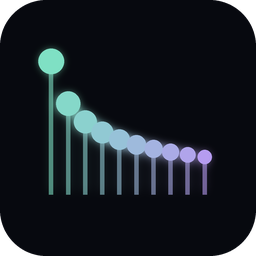
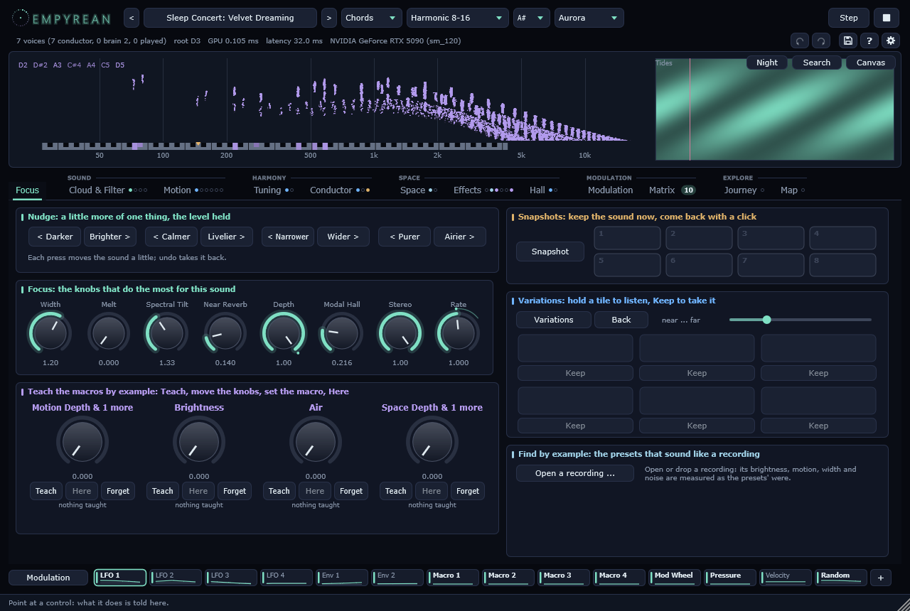

# Empyrean

An additive ambient synthesizer: every voice is **twenty thousand sine waves**, computed on the graphics card. Each
harmonic of a note is not one sine but a cloud of slightly detuned ones, every partial with envelopes of its own --
its loudness, its pitch and its place in the stereo field each follow a loop of their own -- so that a held chord never
stands still. It plays by itself, after Noctuary's conductor: a chord in just intonation that changes one voice at a
time, minutes apart, in the spirit of Robert Rich's sleep concerts.

**VST3 plugin and standalone application** for Windows (x64) with an **NVIDIA GeForce RTX** card (20 series or newer),
and a command-line renderer. Licence: AGPL-3.0. The empyrean is the highest heaven, the one made of light.

<br clear="left" />



## Download

Not released yet: build it from source (below). The release will bring a setup with the standalone, the VST3, the
offline renderer and the manual, and a portable zip.

## How it is put together

- **The GPU** (`Core/src/Cloud.cu`, CUDA 13.4): 16 voices x 20,000 partials. Per block of 128 samples one CUDA graph:
  an update kernel per partial (its frequency and glide, four amplitude ramps, its three envelopes, the filter's
  response at its frequency, its distance), a render kernel (a thread per sample, 512 partials per chunk, phases in
  32-bit fixed point), a reduction in a fixed order (bit-identical renders); then, in the same graph, the **modal
  hall**: 65,536 decaying resonances, a thread each, fed by the block the voices just made, summed with warp shuffles.
  The spectral echo, an FFT of its own in one CUDA block, runs after it. On an RTX 5090, with twelve voices and the
  second conductor sounding: 0.10 ms of GPU time per block of 2.7 ms, and 0.17 ms with every effect on (6 %).
- **The real-time path** (`Core/src/Engine.cpp`): a worker thread (MMCSS Pro Audio) renders ahead into a ring by two
  host blocks and ten milliseconds; the audio callback stamps notes and copies. A note begins on its exact sample. The
  standalone puts the process into Windows' REALTIME GPU priority class: without it another program's graphics could
  hold the card for 20 ms.
- **On the CPU**, what works on the sum: Noctuary's echoes, near room, diffusion, far reverb and unmask, the bass
  made mono, mid/side, the soft clip -- and the conductor, the modulation, the tuning.

## The sound

- **The spectrum** (Noctuary's formula, per partial): Tilt, Brightness, Odd / Even, Inharmonic (a stiff string's
  stretch), Presence, Pad Low Cut. The voice is normalised after the whole shape: colour changes the sound, not the level.
- **The cloud:** its width in cents and how it widens to the top, every partial's drift and shimmer, its place in the
  stereo field; **Air**, a band of flickering partials heard as noise.
- **Motion:** Random, Wave, Pendulum, Breathe, Glissando, Aurora -- the partials' envelopes set all at once; Aurora
  reads a **landscape** (time against frequency): Aurora, Shepard, Tides, Rain, Choir.
- **The field**, a force on every partial's frequency, carried from block to block on the GPU: Scale gathers the
  cloud into the key, Swarm lets attractors on chaotic (Lorenz) paths gather the partials near them, Scatter parts
  them like dust. **Dispersion** makes each partial's clock late by its pitch: attacks and glints fall as cascades.
- **The filter** as an exact frequency response at every partial: LP 6/12/24, HP 12, BP 12, Notch, Peak, Formant.
- **Tuning:** equal temperament, the just scales, the harmonic series, slendro, Bohlen-Pierce, and Timbre -- the scale
  the cloud's own spectrum asks for (Sethares). Purity narrows the clouds so that just intervals can lock.
- **Space** (Noctuary's): every note on a plane between the ear and the far background, quieter, darker and heard only
  through the far reverb the farther it stands; Breath, Doppler. The far reverb with Noctuary's diffusion, pre-delay,
  unmask, its four networks and freeze.
- **Echoes and rooms** (Noctuary's): two asymmetric delays in series, receding into the far plane; early reflections
  and a small reverb for the near plane.
- **The modal hall:** a reverb made the way the instrument is made, sixty-five thousand resonances that die away, on
  the GPU. Tuned, a share of them stands on the pitches of the scale and the hall rings in key, like sympathetic
  strings; Decay up to a minute, Damping, Spread, Drift, Width, Lowest, Breath (its colour moves), Paint (heard
  through the landscape), Freeze. It **grows**: it remembers what it heard, band by band, over minutes to hours, and
  rings longer there (or erodes); the memory stays with the session and can be saved and loaded.
- **The spectral echo:** five hundred bands, each with a delay line of its own on the GPU: tilted, scattered, fed back.
- **Memory:** every note let go leaves a ghost that blooms after it, fades over minutes, blurs and recedes.
- **Binaural** (headphones): every partial of the near plane at a point of its own round the head -- head shadow,
  pinna and the time round the head, worked out per partial; the whole cloud can orbit the listener.
- **Self-Tune:** voices whose harmonics nearly meet pull together; an equal-tempered chord settles to just intervals.
- **The conductor:** Free or Chords (Autoplay), Step, and Brain 2, a second conductor deep in the background.
- **Living systems:** a Lenia or Turing field grows on the GPU and the partials follow it; partials fall into step
  (Kuramoto sync); clouds fly as flocks; every note sends a ripple along the spectrum; the Melt holds the spectrum and
  lets it flow into the space between the notes.
- **Modulation:** four LFOs without hard edges, two envelopes, four macros, mod wheel, pressure, velocity and a random
  curve; Noctuary's Lenia, Lorenz, Roessler and Kuramoto; the Beat, the conductor's Cascade, Root Age; what the
  instrument hears (loudness, brightness, change, roughness); a reservoir of 2048 neurons on the GPU -- through a
  matrix of sixteen rows, each with a via source, and every source drawn live.
- **Spectral means only an additive instrument has:** Stretch (Sethares' stretched timbres, with a tuning made from
  them), Shift (a frequency shifter), a spectral comb whose notches travel without end, your own picture or recording
  as a landscape, and animated pictures after the Kaleidoscope visualizer -- kaleidoscope, tunnel, endless spiral,
  flow, feedback, rain, starfield, moire -- read by every partial.
- **The preset map:** every preset on a square by how it sounds, measured (darker to brighter, still to moving); the
  cursor blends the presets round it, routes walk it with a travel and a hold time for each waypoint.
- **Simple ways in (the Focus page):** nudges (brighter, calmer, wider, airier) built on a measure of what every knob
  does, the few knobs that matter for this sound, variations to evolve a sound by ear, macros taught by example, and
  presets found by a recording.
- **ASIO** in the standalone, a meter, A | B against the preset, zoom; the tuning and the journeys drawn; words in the
  palette ("dark calm wide").
- **By hand:** a journey written on its timeline (edges, glides, order), the hall's memory painted, the map's waypoints
  dragged, the scale's pitches played on the tuning's ruler; the map zooms and moves, with names at the points.
- **Sources in sight:** a modulation dock with every source live -- drag one onto any knob; the pages in sections,
  each showing what is on in it; a window as large as the screen allows.
- **A panel to find one's way in:** your own presets, a preset browser by how they sound, a command palette (Ctrl+K),
  an info line that explains every control, snapshots, macros as named knobs, a night mode and first steps.
- **A panel that takes the hand:** the picture shows what the page in front edits and lets it be dragged (the filter's
  curve, the air's band, the register, the hall's lowest mode); a Canvas mode for listening; every modulation as an
  arc round its knob, made and changed from the knob's menu; the space seen from above.
- **Swarms, fluids and turbulence:** the partials' oscillators as chimeras (an ordered core in a disordered cloud) or
  as swarmalators (phase waves circling through pitch and field); a real fluid (lattice Boltzmann) the notes blow ink
  into, and an oil-and-water separation that gathers into islands, as living landscapes; the energy cascade of a gong.
- **MPE:** every note its own bend, pressure and slide (Push 3, Osmose, Linnstrument, Seaboard), each moving a target.
- **The partials' own time and orbits:** each partial's clock slower (or faster) where the spectrum is dense; the
  ripple lingering at the notes; the Orbit field, the scale's pitches as wells and a magnetic field bending every
  partial into circles of pitch and place.
- **The harmonics' own lives:** registers that overblow as in a flute, seasons of overtone families taking turns,
  avalanches on a rice pile running up the harmonics, subharmonics pumped from below (a floor that opens under a held
  chord); grains, a horizon the harmonics crowd under, breathers on the ripple.
- **Dreams and phantoms:** 2048 tuned chimes over the field, rung by a simulated wind (lattice Boltzmann); a melody
  heard only between the ears (dichotic pitch, headphones); the instrument dreaming of what it played, by association
  (a modern Hopfield network over its own spectra); the conductor's notes heard coming, as a reverb backwards; timbres
  that fall apart and come back whole (Talbot's effect) or swing up and down the harmonics (Bloch).
- **Weather and growth:** rain where the showers the wind carries are (bubbles singing on water, a tin roof in
  tune), leaves rustling in its gusts, a sea breaking in sets; a plate everything rings, its energy blooming upward as
  a tam-tam's; the partials riding swarmalators round the listener, or crawling as a slime mould between the harmonics.
- **Rooms and topology:** a room simulated as air (the wave equation on a quarter of a million cells: its modes and
  standing waves, a listener who walks through them); a topological insulator of sound round the listener, its rim
  carrying the notes round one way only; the conductor's root walking as a quantum wave on the Tonnetz.
- **The night:** an Aeolian harp in the wind (each string's vortices locking onto one of its harmonics), thunder from
  a lightning channel laid out anew at every strike (an N-wave from each segment, heard as late as it is far), a frozen
  lake singing as the cold cracks it (dispersive chirps from a sheet in its critical state), a night chorus of two
  thousand insects and frogs answering each other in bands of their own; the real night where you are, from the sun's
  height, darkening and slowing the sound.
- **Illusions and mirrors:** streams that part a voice into several sounds or fuse it again (common fate), Risset's
  rhythm that slows for ever, a time-reversal mirror in the wave room that sends every sound back to where it came from;
  the dream's memories kept with the project.
- **The headset in the cloud:** with Empyrean's own Quest app the binaural cloud and the thunder stay put as the head
  turns, and the hands reach into the wind, the halo, the wave room and the slime mould's trail.
- **The floor:** a foundation under the conductor that keeps its depth through any filter; Floor holds a share of the
  sound under 150 Hz (raising the foundation's depth while the rest covers it), Pedal an organ point, Pressure a slow
  beat as of two pipes a hair apart, a sub octave and a fifth that breathe. Every preset stands on one.
- **Stars and gravity:** a star's oscillations heard (asteroseismology: a sun, a red giant, a white dwarf, each mode a
  Lorentzian line kept ringing by noise), a black hole that redshifts the partials falling into it and lenses the
  rest into a ring, black holes merging (an inspiral felt in the field's width, a ringdown in the bass), a modal hall
  whose tails sink for ever.
- **Light and depth:** partials that twinkle through a drifting screen of turbulence (Fresnel diffraction per band),
  hydrogen's spectral lines as a timbre (Zeeman triplets, Doppler widths) and its dark lines carved into the sound, a
  derelict's structure ringing in modes worked out from a mass-spring model, the ocean's deep sound channel traced ray
  by ray.
- **Plasma and voice:** the magnetosphere as a VLF radio hears it (whistlers dispersed along the field lines, the
  dawn chorus, hiss) and the throat of the abyss: giant vocal tracts (Kelly-Lochbaum) whose ventricular folds sing an
  octave below (kargyraa).
- **16384 presets** in 256 groups (sounds, living systems, sleep concerts with slow modulations made for the night,
  visions, swarms and currents, halls and orbits, harmonic lives, dreams and phantoms, weather and growth, rooms and
  topology, night and illusions, choruses and mirrors, deep floors, stars and gravity, light and depth, plasma and voice), levelled by their loudness (ITU-R BS.1770); and a map that
  grows itself (MAP-Elites, Tools/presets/grow.py) into presets of your own.
- **Glide, morph and journeys:** a preset glides out of the one before -- the partials themselves travel, each sound's
  modulators with them, the filters moving into each other by transport; a morph knob between two slots; and
  journeys, presets in a row glided into each other for a whole night (531 come with it, nineteen of them whole nights),
  each shown with its length, and rendered into WAV, FLAC, Ogg Vorbis or MP3 by Empyrean Journeys.

## Build

Windows, Visual Studio 2026 with C++, CUDA 13.4 (in its default folder), CMake 3.30 or newer; JUCE is fetched.

```
cmake --preset msvc
cmake --build --preset msvc
ctest --preset msvc
```

The programs land in `bin/msvc`. The tests: the engine's self-test, the GPU probe's, the documentation check (every
entity documented, Doxygen) and pluginval at strictness 10 (where it is unpacked). `Deploy/build_release.ps1` builds
the release (`release` preset: static runtime, code for every RTX generation), runs the tests, makes the manual,
stages, checks and packs it into `dist/`.

## Render

```
empy_render --seconds 600 --preset "Velvet Dreaming" --out night.wav
empy_render --seconds 60 --no-brain --chord 50,57,62,66 --hold 40 --set motion=Aurora
```

`--set` takes any key of the parameter table; `--dump-params` writes the table as JSON (the manual is made from it).

**Empyrean Journeys** (`EmpyreanJourneys.exe`, in the Start menu) renders journeys into files with a small window of
its own: every journey listed with its length, one or several chosen, written as WAV or FLAC (24 bit), Ogg Vorbis or
MP3 (320 kbit/s), faster than real time. The same from the command line:

```
EmpyreanJourneys --render "Whole Night - Lullabies" --format flac --out lullabies.flac --seed 7 --passes 2
EmpyreanJourneys --list --seed 7
EmpyreanJourneys --selftest 6
```

## The family

Noctuary, Ephemeris, Phosphene, Totality, Parhelion: the same window frame, the same keys, the family jam (one
leads, the others follow its root) and the Meta Quest app's hands in bridge mode. The Quest itself has no card for
twenty thousand partials per voice; this instrument stays on the computer.

## Licence

AGPL-3.0 (`LICENSE`). Built with JUCE and NVIDIA's CUDA; the CUDA runtime is linked statically under NVIDIA's licence
for it.
